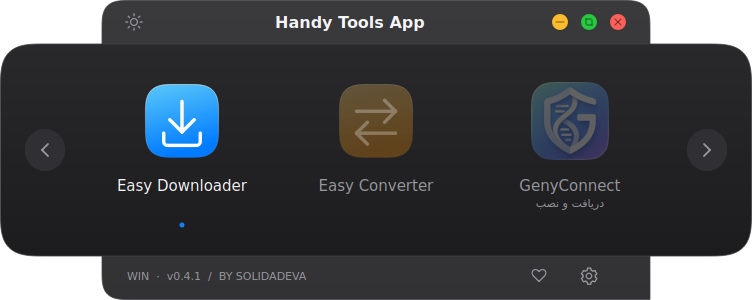

# Handy Tools App

A compact Windows/macOS launcher for **Easy Downloader** and **Easy Converter**, with shared light/dark themes and independent tool windows.



## Install

Download the latest **HandyToolsApp-Windows** ZIP from [Releases](https://github.com/solidadeva/HandyTools/releases/latest), extract it, run `Install.bat` once, then `Start.vbs`. Requires 64-bit Python 3.11 or later. Alternatively, download the Windows-x64 `.exe` release asset for a standalone app requiring no Python installation. It can be moved by itself, including to the Desktop.

## Updates

Open **Settings (gear) → Check for updates**. The updater compares SHA-256 hashes and downloads only changed app files from the immutable release commit. FFmpeg, media files, settings and the existing Python environment are retained. New dependencies are installed only when requirements change. Installation waits for the app to close, backs up changed files, applies the update and restarts. On failure, app files are rolled back; dependency-environment changes cannot be rolled back automatically.

Versions 0.1/0.2 need one initial upgrade to 0.3.0 to obtain the updater. Portable EXE v0.4.3 and later supports Settings updates: it downloads the complete new EXE, checks SHA-256, closes the app, replaces the executable and restarts. FFmpeg and user data are retained. EXE v0.4.2 and earlier needs one manual download to enable this.

## Launcher

Version 0.4.0 adds the official **GenyConnect** launcher entry. It starts uninstalled; click to download and install the correct official platform package. SHA-256 is checked before execution, and an existing installation opens directly. GenyConnect binaries are not bundled. Windows uses the upstream NSIS installer and normal UAC; macOS uses a user Applications installation, and Linux uses the official AppImage. Native Windows/macOS installation still needs platform validation.

The drawer now has continuous corners, traffic-light window controls, a sharp lower-right corner with a tiny five-second pulsing resize triangle, and frameless bright/dim app selection with a blue dot.

The v0.3.1 interface uses an Apple-inspired visual language: silver/graphite surfaces, fine separators, blue controls and original continuous-corner gradient icons. Existing structure and behavior are preserved.

- Smaller initial size; drag the lower-right grip to resize. Last size is remembered.
- Mouse wheel, swipe/drag, arrows and Left/Right keys navigate; click or Enter opens a tool.
- Settings controls themes and updates. Donate remains a visual placeholder.
- Converter supports HEIC primary-image decoding and ten output formats.
- Downloader explicitly converts video to 8-bit H.264/AAC MP4 for editing.

## Development and releases

Install `requirements.txt`, ensure FFmpeg is on PATH, then run:

```sh
QT_QPA_PLATFORM=offscreen python -m unittest discover -s tests -p 'test_*.py'
```

Increase `version.py`, update `RELEASE-NOTES.md` and push to `main`. The release workflow tests the app on Linux, builds and validates a standalone EXE on Windows x64, then publishes the EXE, SHA-256 checksum, source ZIP and per-file update manifest. Existing releases are not overwritten.

See [راهنمای فارسی](README-fa.md) and [third-party notices](THIRD-PARTY.md).

## Windows EXE build

Run `Build-Windows.bat` after `Install.bat`. The standalone output is `dist/portable/HandyToolsApp.exe`. The build validates it from an isolated directory containing only that EXE, before creating the release artifact and SHA-256 checksum. GitHub Actions builds and smoke-tests the Windows x64 executable before publishing.

Old onedir builds at `dist/HandyToolsApp/HandyToolsApp.exe` must retain their complete `_internal` directory. A `Failed to load Python DLL ... _internal/python312.dll` error after moving only that old EXE is resolved by restoring the complete folder, creating a shortcut, or rebuilding with the new script. Updating source files does not change an already-built EXE; rebuild or download the new standalone release. The EXE updater downloads the complete standalone executable; per-file transfers remain available for the Python source edition.

## macOS 15 or later

Download the **macOS-arm64 DMG** for Apple Silicon (M1/M2/M3/M4 or newer) or **macOS-x86_64 DMG** for Intel. Open the DMG and drag HandyToolsApp into Applications, then launch the installed app. Python, Homebrew, FFmpeg and Deno are not needed on the user's Mac; native media tools are included. The Mac downloader uses an isolated native yt-dlp worker, with verified H.264/yuv420p + AAC MP4 or MP3 output and cancellation. Windows retains its existing PowerShell engine.

These first Mac builds are ad-hoc signed, not Apple Developer signed/notarized. If macOS blocks first launch, review the release origin and use System Settings → Privacy & Security → Open Anyway for this app. No global security settings need to be disabled.

Mac Settings can check for the correct architecture's update, download and verify its SHA-256, then open the DMG. Quit the app and replace it in Applications with Finder; app-bundle replacement is not automatic yet. Windows EXE updating and Python per-file updating retain their existing behavior.

To build on a Mac: install native `ffmpeg` and `deno` using Homebrew, install requirements-build.txt in a virtual environment, then run `python build_macos.py`. GitHub Actions builds both architectures and tests relocated app startup with Homebrew removed from PATH, bundled tools, real media conversion, native MP4/MP3 downloads against a local HTTP server, signatures and DMG integrity. Live YouTube access is not used as a CI dependency.
